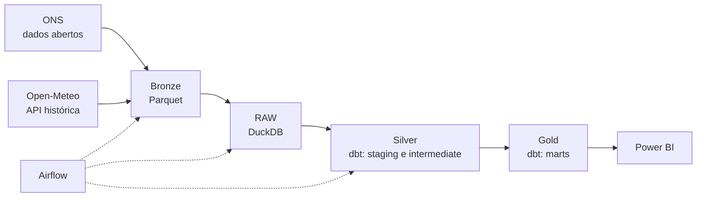

# Energy Analytics

Plataforma analítica para integrar, processar e modelar dados públicos do **setor elétrico brasileiro**, relacionando demanda, geração de energia e clima. Projeto de portfólio de Analytics Engineering, desenvolvido em fases, do problema de negócio até o dashboard.

> **Status:** em desenvolvimento. A Fase 00 (ambiente de desenvolvimento) está concluída; as demais fases estão descritas no [roadmap](#roadmap).

## Perguntas de negócio

- **Demanda elétrica:** como a demanda evolui ao longo do tempo? Quais os períodos de maior demanda? Como os subsistemas se comportam?
- **Clima e energia:** existe associação entre temperatura e demanda? Como a relação varia por região? Quais períodos são atípicos?
- **Geração de energia:** como a geração varia por fonte e por subsistema? Como se relaciona com a demanda?

## Arquitetura

Arquitetura medalhão, com Parquet como armazenamento de aterrissagem e DuckDB como warehouse analítico local.



| Camada | Responsabilidade | Implementação |
|---|---|---|
| Bronze | Preservar os dados originais | Arquivos Parquet |
| RAW | Dados brutos em tabelas | DuckDB + Python |
| Silver | Limpeza, padronização e integração | dbt (staging e intermediate) |
| Gold | Modelagem dimensional e regras de negócio | dbt (marts) |
| Apresentação | Indicadores e visualizações | Power BI |

## Stack

| Responsabilidade | Tecnologia |
|---|---|
| Ingestão | Python |
| Orquestração | Apache Airflow 3 |
| Armazenamento de arquivos | Apache Parquet |
| Data warehouse | DuckDB |
| Transformações e testes | dbt (dbt-core 1.x com dbt-duckdb) |
| Apresentação | Power BI |
| Ambiente | Docker Compose, GitHub Codespaces (dev) e VM Azure (produção, planejada) |
| Versionamento e CI/CD | Git, GitHub, GitHub Actions (planejado) |

As versões das dependências Python estão fixadas em `requirements.txt` e `requirements-dbt.txt`. O dbt roda em um virtualenv separado dentro da imagem do Airflow, para evitar conflitos de dependências.

## Fontes de dados

- **ONS (Operador Nacional do Sistema Elétrico):** carga e geração de energia por subsistema, pelo [Portal de Dados Abertos](https://dados.ons.org.br/). Licença CC BY 4.0.
- **Open-Meteo:** dados meteorológicos históricos por localização, pela [API de histórico](https://open-meteo.com/en/docs/historical-weather-api). Uso gratuito apenas não comercial, com atribuição (CC BY 4.0).

## Como executar (GitHub Codespaces)

1. No GitHub, abra o repositório e crie um Codespace (`Code`, depois `Codespaces`, depois `Create codespace on main`). Uma máquina de 2 cores e 8 GB atende ao requisito do devcontainer.
2. Aguarde a criação. O devcontainer gera o arquivo `.env` com segredos locais aleatórios, constrói a imagem e sobe o Airflow e o PostgreSQL.
3. Na aba **Ports** do VS Code, abra a porta `8080` e mantenha a visibilidade **Private**.
4. Entre no Airflow com o usuário `admin`. A senha é gerada em um arquivo:

   ```bash
   cat .local/airflow/simple_auth_manager_passwords.json.generated
   ```

5. Despause a DAG `smoke_test` e dispare-a. As duas tarefas (`dbt_version` e `check_duckdb`) devem terminar com sucesso.

Para reiniciar o ambiente manualmente: `bash .devcontainer/start.sh`. Para ver o estado dos serviços: `docker compose ps`.

## Estrutura do repositório

```
energy-analytics/
├── .devcontainer/        # ambiente do Codespace (Dockerfile, devcontainer.json, setup.py, start.sh)
├── .github/workflows/    # CI/CD (planejado, Fase 07)
├── dags/                 # DAGs do Airflow (hoje: smoke_test)
├── docker/airflow/       # imagem do Airflow: libs de ingestão e dbt em virtualenv
├── ingestion/            # extratores Python (planejado, Fase 03)
├── dbt/energy_analytics/ # projeto dbt (planejado, Fase 05)
├── powerbi/              # projeto Power BI (planejado, Fase 08)
├── docs/                 # documentação do projeto (planejado)
├── data/                 # Bronze em Parquet (local, fora do Git)
├── warehouse/            # arquivo DuckDB (local, fora do Git)
├── docker-compose.yaml
├── .env.example
├── requirements.txt
├── requirements-dbt.txt
└── README.md
```

O mesmo `docker-compose.yaml` atende dev e produção por meio de *profiles* (`COMPOSE_PROFILES` no `.env`): `dev` é o padrão. O profile `prod` está definido, mas ainda não foi validado em uma VM.

## Roadmap

| Fase | Foco | Status |
|---|---|---|
| 00 | Fundação: repositório e ambiente | Concluída |
| 01 | Negócio e requisitos | A fazer |
| 02 | Arquitetura e modelagem | A fazer |
| 03 | Ingestão Bronze (Parquet) | A fazer |
| 04 | Warehouse RAW (DuckDB) | A fazer |
| 05 | Transformações dbt (Silver e Gold) | A fazer |
| 06 | Orquestração e produção | A fazer |
| 07 | CI/CD e documentação | A fazer |
| 08 | Power BI | A fazer |
| 09 | Validação e publicação | A fazer |

O acompanhamento detalhado está nos milestones e nas issues do repositório.

## Padrões de desenvolvimento

- Commits em inglês, seguindo [Conventional Commits](https://www.conventionalcommits.org/) (`feat`, `fix`, `docs`, `chore`).
- Nomes de tabelas e colunas em inglês; documentação em português.
- Mudanças por branch e pull request; a `main` é a fonte do que roda em produção.
- Dados, o arquivo `.duckdb` e o `.env` nunca vão para o Git.
- Ingestão idempotente: reprocessar um período não duplica dados.
- Tasks que gravam no DuckDB usam a pool `duckdb` do Airflow, pois o DuckDB aceita um escritor por vez.

## Decisões e limitações conhecidas

- O dbt está fixado na linha 1.x. O dbt v2 já inclui um adaptador DuckDB embutido, mas ainda há diferenças de recursos em relação ao dbt-duckdb; a migração será reavaliada depois da versão 1.0 do projeto.
- A autenticação do Airflow (SimpleAuthManager) serve ao desenvolvimento. Para produção, será definida outra estratégia e a porta do Airflow ficará fechada.
- O ONS publica arquivos mensais em CSV, XLSX e Parquet, e o Parquet não existe para todos os meses; a ingestão usará CSV quando necessário.
- O Open-Meteo gratuito é restrito a uso não comercial e tem limite de chamadas por dia.

## Licença

Distribuído sob a licença MIT. Veja o arquivo `LICENSE`.

## Atribuições

- Dados de energia: ONS, Operador Nacional do Sistema Elétrico, licença CC BY 4.0.
- Dados meteorológicos: [Open-Meteo.com](https://open-meteo.com/), licença CC BY 4.0.