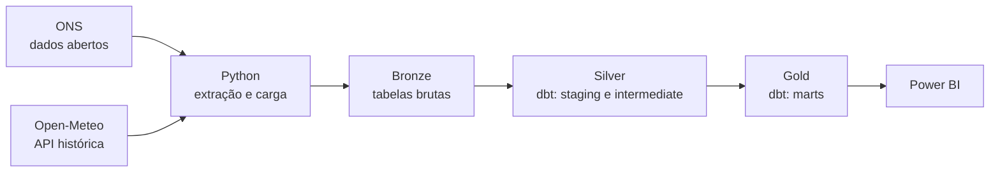

# Energy Analytics

Plataforma analítica sobre o **setor elétrico brasileiro**: integra dados públicos de demanda e geração de energia (ONS) com dados climáticos (Open-Meteo) para responder perguntas de negócio com modelagem dimensional, testes e dashboards. Projeto de portfólio de **Analytics Engineering**, desenvolvido em fases, do dado bruto ao insight.

> **Status:** em desenvolvimento. A Fase 00 (fundação e ambiente) está concluída e a Fase 01 (negócio e requisitos) está em andamento: a exploração das fontes (ONS e Open-Meteo) e as escolhas de cidades, granularidade e janela de análise estão feitas, e os requisitos estão escritos em [`docs/requirements.md`](docs/requirements.md), em revisão; veja o [roadmap](#roadmap). A versão anterior do projeto (Airflow, DuckDB e Docker Compose) está preservada na tag `v0-airflow-duckdb`.

## Perguntas de negócio

**Demanda elétrica**
- Como a demanda evolui ao longo do tempo?
- Quais são os períodos de maior demanda?
- Como os subsistemas se comportam?

**Clima e energia**
- Existe associação entre temperatura e demanda?
- Como essa relação varia por região (subsistema)?
- Quais períodos apresentam comportamentos atípicos?

**Geração de energia**
- Como a geração varia por fonte e por subsistema?
- Como a geração se relaciona com a demanda?

## Indicadores (proposta, a validar na Fase 01)

- Carga média diária por subsistema, variação anual e participação no SIN.
- Ranking de maior demanda (dias e meses).
- Temperatura média por subsistema, graus-dia de resfriamento e correlação entre carga e temperatura.
- Dia atípico (carga fora do esperado para o mês e o dia da semana).
- Geração por fonte, participação por fonte, cobertura da carga e saldo de intercâmbio.

## Arquitetura

Arquitetura medalhão no Snowflake, com transformações em dbt e consumo no Power BI.



| Camada | Responsabilidade | Implementação |
|---|---|---|
| Bronze | Preservar o dado original, sem regras de negócio | Python e Snowflake |
| Silver | Limpeza, tipagem, padronização e integração | dbt (staging e intermediate) |
| Gold | Modelo dimensional e tabelas para as perguntas de negócio | dbt (marts) |
| Apresentação | Indicadores, análises e insights | Power BI |

## Stack

| Responsabilidade | Tecnologia |
|---|---|
| Ingestão | Python |
| Data warehouse | Snowflake (conta trial); migração futura possível para Databricks |
| Transformação, testes e documentação | dbt Core 1.x com dbt-snowflake |
| Apresentação | Power BI |
| Ambiente de desenvolvimento | GitHub Codespaces com devcontainer |
| Versionamento | Git, GitHub e Conventional Commits |
| CI/CD e agendamento | GitHub Actions (planejado) |

Fora desta versão: Airflow, Docker Compose, DuckDB e PySpark. O Airflow pode ser avaliado em versões futuras.

## Fontes de dados

- **ONS (Operador Nacional do Sistema Elétrico):** carga e geração de energia por subsistema, pelo [Portal de Dados Abertos](https://dados.ons.org.br/). Licença CC BY 4.0.
- **Open-Meteo:** dados meteorológicos históricos por localização, pela [API de histórico](https://open-meteo.com/en/docs/historical-weather-api). Uso gratuito apenas não comercial, com atribuição (CC BY 4.0). Modelo `era5_seamless`, temperatura média e precipitação diárias, uma cidade por subsistema (São Paulo, Curitiba, Fortaleza e Manaus). A janela de análise é de 2019 em diante.

Os achados da exploração das duas fontes (contratos, qualidade, limites e decisões de tratamento) estão em [`docs/data_sources.md`](docs/data_sources.md).

## Como executar

O projeto é desenvolvido no GitHub Codespaces.

1. No GitHub, abra o repositório e crie um Codespace (`Code`, depois `Codespaces`, depois `Create codespace on main`).
2. Aguarde a criação: o devcontainer prepara o ambiente Python com as dependências de `requirements.txt`.
3. Confira o ambiente no terminal:

   ```bash
   python --version
   dbt --version
   ```

Ainda não há pipeline executável: o ambiente está pronto e as próximas fases adicionam a ingestão, o Snowflake e os modelos dbt. As credenciais do Snowflake serão lidas de variáveis de ambiente (veja `.env.example`) e **nunca** são versionadas.

## Estrutura do repositório

```
energy-analytics/
├── .devcontainer/          # ambiente do Codespace
├── .github/workflows/      # CI e agendamento (planejado)
├── ingestion/              # extração e carga em Python (planejado)
├── snowflake/              # SQL de provisionamento (planejado)
├── dbt/energy_analytics/   # projeto dbt: staging, intermediate e marts (planejado)
├── powerbi/                # projeto do Power BI (planejado)
├── docs/                   # planejamento, estado, dicionário de métricas e fontes de dados
├── scripts/                # exploração das fontes (ONS e Open-Meteo), uso local
├── .env.example
├── requirements.txt
└── README.md
```

## Roadmap

| Fase | Foco | Status |
|---|---|---|
| 00 | Fundação e ambiente | Concluída |
| 01 | Negócio e requisitos | Em andamento |
| 02 | Arquitetura e modelagem | A fazer |
| 03 | Ingestão com Python | A fazer |
| 04 | Snowflake: provisionamento e Bronze | A fazer |
| 05 | dbt: Silver | A fazer |
| 06 | dbt: Gold | A fazer |
| 07 | Power BI e insights | A fazer |
| 08 | Automação, CI/CD e documentação | A fazer |
| 09 | Encerramento do trial, portabilidade e publicação | A fazer |

O acompanhamento detalhado fica nos milestones e nas issues do repositório.

## Padrões de desenvolvimento

- Commits em inglês, seguindo [Conventional Commits](https://www.conventionalcommits.org/).
- Nomes de tabelas e colunas em inglês; documentação em português.
- Mudanças por branch e pull request; a `main` é a fonte do que é publicado.
- Dados, chaves e arquivos `.env` nunca vão para o Git.
- Métricas definidas uma vez, na camada Gold, e documentadas.

## Decisões e limitações conhecidas

- A conta do Snowflake é um trial com prazo (termina por volta de fevereiro de 2027). O projeto prevê exportar snapshots e documentação estática no fim, para continuar demonstrável sem o warehouse ativo.
- O dbt começa na linha 1.x, madura e portátil para outros warehouses; o dbt v2 será reavaliado depois da versão 1.0.
- Código específico de warehouse fica isolado na camada de carga, para facilitar uma migração futura para o Databricks.
- O ONS publica arquivos mensais em CSV, XLSX e Parquet, e o Parquet não existe para todos os meses; a ingestão usará CSV quando necessário.
- O Open-Meteo gratuito é restrito a uso não comercial e tem limite de chamadas (600 por minuto, 10.000 por dia). Nas medições, a carga histórica de 11 cidades custa cerca de 1.540 chamadas, a API dá timeouts ocasionais (a ingestão precisará de retry) e os dados do ERA5 chegam com cerca de 7 dias de defasagem.

## Licença

Distribuído sob a licença MIT. Veja o arquivo `LICENSE`.

## Atribuições

- Dados de energia: ONS, Operador Nacional do Sistema Elétrico, licença CC BY 4.0.
- Dados meteorológicos: [Open-Meteo.com](https://open-meteo.com/), licença CC BY 4.0.